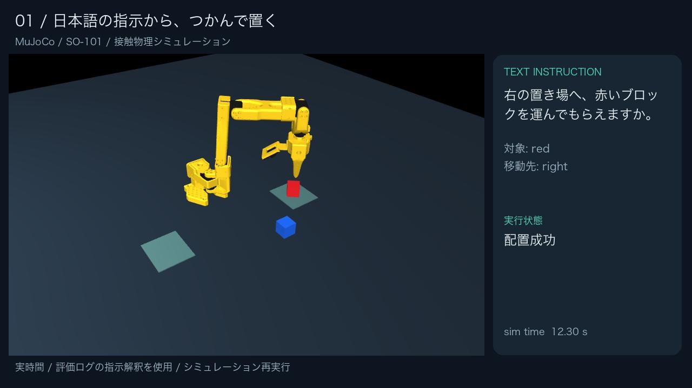

# 言葉が通じても、つかめるとは限らない

**SO-101 × 日本語テキスト指示 × ローカルLLM × MuJoCo**

卓上の色付きブロックを左右の置き場へ運ぶ実験です。言葉の解釈、対象の確認、物理的な成功を分け、失敗も記録します。音声・画像認識・実機実験は行っていません。



## 結果

24指示×3配置、方式ごと72試行。言語モデルの出力は24件を各方式・配置で共有しています。

| 方式 | 正常な作業の完了 | 確認・拒否が適切 | 全体 |
|---|---:|---:|---:|
| 最初の単語＋確認 | 21/36 | 27/36 | 48/72 |
| LLM・確認なし | 36/36 | 21/36 | 57/72 |
| LLM＋確認 | 36/36 | 33/36 | 69/72 |

初回の位置見積もりに35mmの誤差を加えた12条件では、再試行なし6/12、一度の再試行あり12/12。2回目は正しい位置が得られる条件です。限定的な人工環境での結果であり、実機や日本語一般の性能ではありません。

- [提出用PDF](output/pdf/physical_ai_so101_report.pdf)
- [テキストレポート](REPORT.md)
- [提出動画のダウンロード](https://github.com/Aryu-Tamura/physical-ai-so101-language/releases/latest)
- [固定した評価条件](docs/EVALUATION_PROTOCOL.md)
- [朝の理解・確認手順](docs/LEARNING_GUIDE.md)
- [実機移行メモ（提出外）](docs/SIM_TO_REAL.md)
- [継続用メモ](Codex.md)

## Macで再実行

検証環境はApple M3 / 16GB / Python 3.12。モデルは約2.1GB。APIキー・有料GPUは不要です。下記はリポジトリ直下で実行します。

```bash
python3.12 -m venv .venv
.venv/bin/python -m pip install -r requirements.txt
.venv/bin/python scripts/fetch_language_model.py
.venv/bin/python demo.py --instruction '青ではなく赤を左のトレーに置いて。' --video
```

結果は `outputs/latest_demo.json`、映像は `outputs/latest_demo.mp4`。モデル読込後に実際の推論を行います。macOSで描画する場合はログイン中のデスクトップ環境を利用してください。モデル取得は `model_manifest.json` のrevisionに固定されます。

```bash
# 同じ色が2個なら、勝手に選ばず確認を要求
.venv/bin/python demo.py --instruction '赤いブロックを右に置いて。' --scenario duplicate --video

# 位置誤差による失敗と一度の再試行
.venv/bin/python demo.py --instruction '赤を右に置いて。' --offset .035 --retry --video

# モデルを読み込んだまま、繰り返し入力（各指示で場面を初期化）
.venv/bin/python demo.py --interactive --video
```

色はred/blueの2種類。green/yellowの依頼は不在として拒否。左右はアームに向かい合う人から見た方向（左=y負、右=y正）です。目標領域は物理的な箱ではありません。

## 評価の再実行

```bash
# 新たに24指示をLLM推論し、216試行を実行
.venv/bin/python scripts/run_evaluation.py --output outputs/new_evaluation

# 保存済み推論を再利用し、物理・判断を再評価（LLMの再推論ではない）
.venv/bin/python scripts/run_evaluation.py --reuse-intents

# 位置誤差と再試行の48試行
.venv/bin/python scripts/run_recovery.py --output outputs/new_recovery

.venv/bin/python -m unittest discover -s tests -v
.venv/bin/python scripts/verify_results.py
```

既存結果を保存したまま再試行するには、上記のように新しい出力先を指定してください。`--reuse-intents` に別の出力先を使う場合は、その場所へ元の `intents.json` をコピーしてください。

## 映像・レポートを再生成

```bash
.venv/bin/python scripts/record_examples.py
.venv/bin/python scripts/make_report.py
.venv/bin/python scripts/make_video.py
```

動画は保存済みLLM出力を使用して物理シミュレーションを再実行したもの。シミュレーション映像は実時間再生、説明用の静止画を含みます。日本語フォントはmacOS標準を使用。別OSは `PAI_JP_FONT` と `PAI_PDF_FONT` で日本語フォントを指定してください。MLXの推論はApple Silicon用です。Linux CIはモデルを読み込まず、物理・確認処理を検証します。

## 構成

- `src/language.py`: 実際のQwen推論、単語比較方式、対象の一意性確認
- `src/arm.py`: SO-101、逆運動学、接触把持、時系列記録
- `src/pipeline.py`: 到達可能性、実行、結果確認、一度の再試行
- `data/evaluation_cases.json`: モデルに渡さない正解付きの評価入力
- `outputs/evaluation/`: モデル生出力、216試行、全時系列
- `outputs/recovery/`: 48試行と全時系列
- `scripts/`: 各段階の検証・録画・資料生成

## 既知の限界

色が未指定のT17で、モデルがmove・color=nullを返し、システムが「確認」でなく「拒否」します。評価後にこの結果を消す調整はしていません。将来は不完全な指示と存在しない物体を分けて確認します。多段階指示、任意形状、カメラ認識、音声、実機安全性は対象外です。

## 出典・ライセンス・AI支援

[THIRD_PARTY.md](THIRD_PARTY.md) に上流モデルとライセンス、正確なrevisionを記載。独自コードはMIT、SO-101アセットはApache-2.0。モデル重みは別途ダウンロードします。テーマ・制約は受講者が設定し、実装・評価自動化・資料作成にはCodexの支援を使用しました。講義資料自体は含みません。

## 提出状況

成果物の作成と、YouTube投稿・Omnicampus提出は別工程です。後者はまだ行っていません。アカウントIDを設定し、本人が内容を確認して提出してください。
